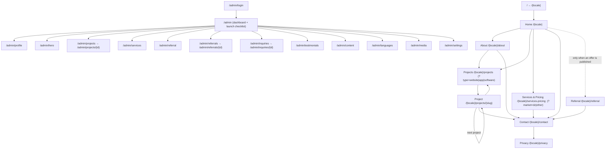
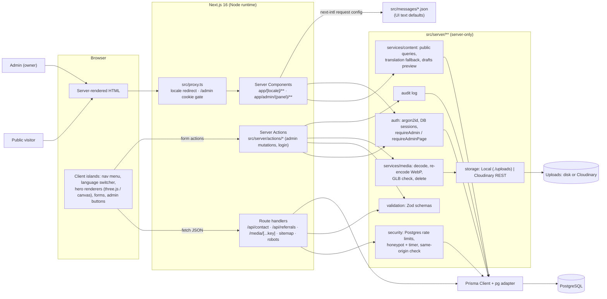
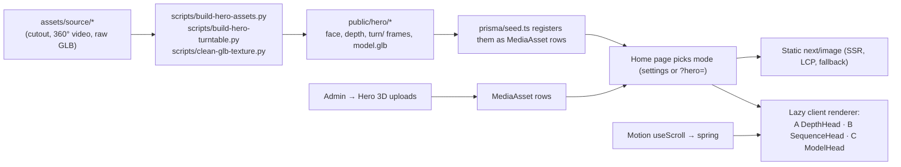

# Architecture

Status: **matches the code** as of 2026-10-10. Update these diagrams in the same change as the code.

---

## 1. Sitemap and navigation

Every public page lives under a locale prefix: `en fr ar it tr es es-MX es-CO pt-BR ru uk nb nl`.
`/` (or any path without a locale) redirects to the visitor's browser language when supported,
otherwise English. Admin routes have no locale and are never linked from public pages.

The header (Home, About, Projects, Services & Pricing, Referral, Contact, language switcher) and the
footer (contact links, socials, language switcher, Privacy) are on every public page; those edges
are left out to keep the graph readable.

---

## 2. Application architecture and data flow

One Next.js app. Everything under `src/server/**` is server-only (`import "server-only"`), so it
can't be bundled into the browser.

- **Rendering:** public pages are dynamic (`force-dynamic`) and read PostgreSQL per request, so
  admin edits show up immediately. Queries are memoised per request with React `cache()`.
- **Text:** UI strings come from `src/messages/{locale}.json` merged along the fallback chain
  (`es-MX → es → en`), then overridden by rows in `PageContent` edited in Admin → Page text.
  Database content (projects, services...) has one translation row per locale, with the same
  fallback chain.
- **Drafts:** public queries return `PUBLISHED` rows only, unless a signed-in admin turned on
  drafts preview (cookie checked together with the session).
- **Public forms** post JSON to route handlers: same-origin check → honeypot/timer → rate limit →
  Zod → insert. Responses are `{ ok }` or `{ ok:false, error, fields }` with error *codes* that the
  browser translates.
- **Admin mutations** are server actions wrapped in `adminAction()`: `requireAdmin()` → work →
  audit log → redirect with a flash message. Next.js checks the Origin header on server actions
  (CSRF).

---

## 3. Database relationships

Matches `prisma/schema.prisma` (migrations in `prisma/migrations/`). Translatable text lives in
`*Translation` tables keyed by `(parentId, locale)`; money is integer minor units (`BigInt`) plus an
ISO-4217 currency.

```mermaid
erDiagram
  AdminUser ||--o{ AdminSession : "signs in with"
  AdminUser ||--o{ AdminAuditLog : writes

  SiteSettings ||--o{ HeroFrame : "option B frames"
  HeroFrame }o--|| MediaAsset : shows
  SiteSettings }o--o| MediaAsset : "heroImage / heroDepth / heroModel / ogImage"

  Profile ||--o{ ProfileTranslation : "per locale"
  Profile }o--o| MediaAsset : portrait
  ExperienceItem ||--o{ ExperienceTranslation : "per locale"

  Project ||--o{ ProjectTranslation : "per locale"
  Project ||--o{ ProjectImage : gallery
  ProjectImage }o--|| MediaAsset : uses
  Project ||--o{ ProjectLink : links
  Project |o--o{ Testimonial : "feedback on"
  Testimonial ||--o{ TestimonialTranslation : "per locale"

  Service ||--o{ ServiceTranslation : "per locale"
  Service ||--o{ ServiceExample : examples
  ServiceExample ||--o{ ServiceExampleTranslation : "per locale"
  PricingPackage ||--o{ PricingPackageTranslation : "per locale"
  PricingPackage ||--o{ PackagePrice : "price per market"

  CountryOffer ||--o{ CountryOfferTranslation : "terms per locale"
  CountryOffer |o--o{ Referral : "applied to"

  AdminUser {
    uuid id PK
    string email UK
    string passwordHash "argon2id"
  }
  AdminSession {
    string tokenHash PK "sha256 of cookie token"
    datetime expiresAt
  }
  SiteSettings {
    int id PK "single row"
    enum heroMode "DEPTH | SEQUENCE | MODEL"
    string contactEmail
    string phone
    bool showPhone
    string whatsapp
    bool showWhatsapp
  }
  MediaAsset {
    uuid id PK
    enum driver "LOCAL | CLOUDINARY"
    string storageKey UK "public:/... = shipped file"
    enum kind "IMAGE | MODEL"
    json alt "per locale"
  }
  Profile {
    int id PK "single row"
    string publicName
    string fullName "hidden unless showFullName"
    string[] languages
    json skills
  }
  Project {
    uuid id PK
    string slug UK
    enum category "WEBSITE | APP | SOFTWARE"
    enum origin "CLIENT | PERSONAL | CONCEPT | null"
    enum stage "CONCEPT | IN_PROGRESS | LAUNCHED"
    enum status "DRAFT | PUBLISHED"
    bool featured
    int sortOrder
  }
  ProjectImage {
    enum kind "REAL | CONCEPT | DEMO"
    int sortOrder
  }
  PackagePrice {
    string market "DZ, FR... or *"
    string currency "ISO 4217"
    bigint minMinor
    bigint maxMinor "null = from"
  }
  CountryOffer {
    string market "DZ... or *"
    string currency
    bigint rewardMinor
    enum category "null = any"
    bigint minProjectValueMinor
    enum status
  }
  Referral {
    enum status "NEW | CONTACTED | QUALIFIED | WON | NOT_ELIGIBLE | REWARD_DUE | PAID"
    bigint rewardMinorSnapshot "reward promised at submission"
    string rewardCurrencySnapshot
    datetime paidAt
    datetime archivedAt
  }
  ContactInquiry {
    enum status "NEW | IN_PROGRESS | REPLIED | CLOSED"
    datetime archivedAt
    bool consent
  }
  Testimonial {
    bool clientApproved "required to publish"
    enum status
  }
```

Tables not drawn (no relations): `LocaleSetting` (enabled / reviewed per language), `PageContent`
(UI text overrides, key + locale), `SocialLink`, `RateLimitBucket` (hashed keys).

---

## 4. Hero 3D

See [hero-3d.md](hero-3d.md).

